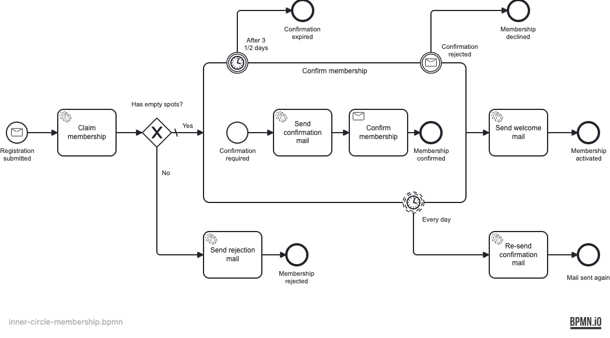

# Distributed Horcruxes

[](https://github.com/emaarco/distributed-horcruxes/actions/workflows/pre-merge.yml)
[](LICENSE)

**Understand the distributed transaction problem between your database and Camunda 8, and fix it with patterns you can run and copy.**

Six runnable Kotlin examples on Spring Boot 4.1 and Camunda 8.10 reproduce the problem and fix it one pattern at a time:
examples to learn from and copy, not a library.

## The problem

A service that saves a membership and then messages Zeebe works with two systems, each with its own commit.
`@Transactional` coordinates only your database, and nothing coordinates the database with Zeebe, so one can succeed
while the other fails. That is the distributed transaction problem. A remote engine brings it into every message you
send and every job you complete:

**When your service sends a message to Zeebe**

1. [**Phantom instance:**](CHALLENGES.md#1-phantom-instance-process-runs-without-data-) the process starts, the commit fails, and the process runs without its data.
2. [**Stale read:**](CHALLENGES.md#2-premature-execution-reading-stale-data-) a worker runs before the commit and does not find the data yet.
3. [**Overwritten data:**](CHALLENGES.md#3-premature-execution-overwriting-data-) steps run out of order and overwrite each other's changes.

**When a worker completes a job**

4. [**Duplicate delivery:**](CHALLENGES.md#4-duplicate-delivery-) at-least-once delivery runs the same job twice: two emails, two claimed spots.
5. [**Lost job completion:**](CHALLENGES.md#5-job-completion-failure-connectivity-issues-) the work is committed, but the completion never reaches Zeebe, so it retries.
6. [**Cancelled job:**](CHALLENGES.md#6-job-completion-failure-task-no-longer-available-) a boundary event cancels the job mid-work, and Zeebe rejects the completion.

This is the price of a remote engine, not a flaw: you trade it for scalability and independent deployment.
[CHALLENGES.md](CHALLENGES.md) walks through each challenge with sequence diagrams.

## What you get

- **The problem, reproduced:** the base scenario runs into phantom instances, stale reads and duplicate spot claims.
- **One pattern per module:** diff an example against the base scenario to see exactly what its pattern adds.
- **End-to-end proof:** [Bruno](https://www.usebruno.com/) scenarios check every path against the process state in Camunda.

## The examples

Every example runs the same membership process: claim one of a few spots, confirm by email, get welcomed.



| Example                                                   | What it does                                                                 | Solves         | Trade-off                            |
| --------------------------------------------------------- | ---------------------------------------------------------------------------- | -------------- | ------------------------------------ |
| [Base scenario](examples/base-scenario/README.md)         | Calls Zeebe inside the transaction                                           | none, shows it | broken on purpose                    |
| [After-transaction](examples/after-transaction/README.md) | Sends to Zeebe only after the commit                                         | 1, 2           | no retry when the call fails         |
| [Outbox](examples/outbox-pattern/README.md)               | Stores messages in the transaction, sends them in order after the commit     | 1, 2, 3        | extra table and latency              |
| [Idempotency](examples/idempotency-pattern/README.md)     | Records finished operations so retried jobs run once                         | 4, 5           | protects only the worker side        |
| [Combined](examples/combined-pattern/README.md)           | Outbox outgoing, idempotency incoming                                        | 1–5            | most moving parts                    |
| [Saga](examples/saga-pattern/README.md)                   | Revokes a committed spot claim with BPMN compensation when a member declines | helps with 6   | starts the process without an outbox |

Most services want the combined pattern. No pattern fully solves challenge 6: model for it as
[CHALLENGES.md](CHALLENGES.md#6-job-completion-failure-task-no-longer-available-) explains, and undo finished work with
compensation like the saga example.

## Get started

You need JDK 21, Node.js 22 and Docker or Podman (`podman compose`).

1. Clone the repository and start Camunda 8 and PostgreSQL:

   ```bash
   git clone https://github.com/emaarco/distributed-horcruxes.git && cd distributed-horcruxes
   docker compose -f stack/docker-compose.yml up -d
   ```

2. Once [Operate](http://localhost:8080/operate) shows its login page, run one of the examples:

   ```bash
   ./gradlew :examples:combined-pattern:bootRun   # port 8081
   ./gradlew :examples:saga-pattern:bootRun       # port 8083
   ```

3. Run the Bruno scenarios and watch the instances in [Operate](http://localhost:8080/operate) as `demo` / `demo`:

   ```bash
   cd bruno
   npx --yes @usebruno/cli@4.0.0 run . --env local --tags pattern -r   # port 8081 examples
   npx --yes @usebruno/cli@4.0.0 run . --env saga --tags saga -r       # saga example
   ```

Restart the example before re-running the scenarios, its spot capacity lives in memory. Switching to or from the saga
example needs a fresh stack: `docker compose -f stack/docker-compose.yml down -v`.

## Help and feedback

- **In depth:** the [blog post](https://medium.com/p/d4bbbca295d6) and the [talk slides](talks/distributed-transactions.pdf).
- **Questions and ideas:** [open an issue](https://github.com/emaarco/distributed-horcruxes/issues).

## Contributing

Pull requests are welcome; building and testing is in [CONTRIBUTING.md](CONTRIBUTING.md).

## License

[MIT](LICENSE) © Marco Schäck
